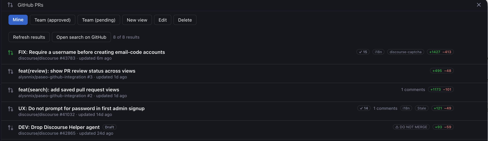

# GitHub PR Views for Paseo

Keep track of GitHub pull requests from Paseo with saved searches, background checks, and quick access to workspace chats.



- Create named views using GitHub search queries. The default **Mine** view shows your open PRs and can be edited or removed.
- See review status, CI checks, labels, comments, and lines added or deleted.
- Read PR details and file diffs in the side panel, approve with one click, open them on GitHub, or start a workspace chat.
- Keep navigating the PR list while details are open; select another PR to switch or click empty list space to dismiss.
- Get view indicators and a sidebar seedling when new PRs match your views.

## Install

Requires Paseo 0.8+ and the GitHub CLI authenticated with `gh auth login` on the machine running Paseo’s daemon.

```sh
paseo plugin add pmusaraj/paseo-pr-views
```

Open **GitHub PRs** in the sidebar. Choose **New view**, enter a name and query, then save. Queries support GitHub filters, AND/OR, and relative dates such as `created:>@today-30d`.

To start a workspace chat, add the PR’s repository as a Paseo project first. You can review the prompt and model before launching.

## Background checks

Edit a view and enable **Add background check**. For existing views, the checkbox saves immediately.

These optional checks run every 2 minutes, with enabled views staggered by 10 seconds in tab order while the daemon is running, even with the app closed. The first check establishes a baseline; newly matching PRs then add green dots to the views and add a **🌱** to the **GitHub PRs** sidebar title. The usual PR icon stays unchanged. Indicators clear when the matching results have been displayed. Views with more than 200 matches retain the daemon's indicator because the displayed results do not cover the entire check.

Background checks support views with up to 1,000 results.

All views with **Add background check** enabled participate, with no four-view limit. The daemon owns the schedule; while Paseo is open, completed checks also refresh up to **200 full results** for the corresponding view, even when the PR screen is closed. Unchecked views load on selection or manual refresh.

Displayed results stay stable while you are using the app. Cached updates are applied when you return to Paseo or select a view. **Refresh results** and pull-to-refresh explicitly fetch and display the latest results. Newly added items in any loaded view add **🌱** to the sidebar title until those items are displayed; status-only changes still appear in that view's update count.

The result summary includes **Last updated N seconds/minutes ago**, based on the displayed results.

The same button handles refreshes and pending updates: it is disabled and reads **Checking for Updates…** during a check, then becomes **Show updates (N)** if changes are ready, or returns to **Refresh results** if nothing changed.

Once the active view has loaded, the next saved view is also preloaded if it has no cached results. This happens only while the app has focus, does not continue through the remaining views, and does not refresh an already-cached next view. Selecting a view shows its cached results immediately; views without cached data are fetched on selection.

## Credits

Based on [paseo-github-integration](https://github.com/alysnnix/paseo-github-integration). MIT licensed.
